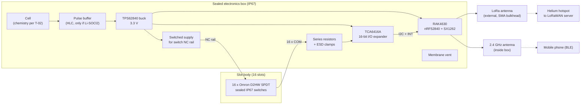

# Slot Sensor: Architecture and part shortlist (T-03)

Status: draft for review. Internal document, not client-facing as written.

Date: 2026-10-31

## 1. Summary

- **Platform**: RAKwireless RAK4630 module (nRF52840 + SX1262 in one certified module). It matches the project's platform preference and no alternative beats it at prototype and low volume.

- **Switches**: Omron D2HW pin plunger, sealed IP67, SPDT, 0.75 N operating force. A 200 g object gives about 1.96 N, so the switch operates with about 2.6x margin (calculated).

- **Switch reading**: SPDT wiring (common to input, NC to switched supply, NO to ground) into a TCA6416A I/O expander. Every input is always driven, so there is no pull-up current path while a slot is occupied. This removes the need for strobed pull-ups, which stay as the fallback.

- **Power**: one cell into a TPS62840 buck (60 nA quiescent per TI) at 3.3 V. T-02's handoff recommends one D-size Li-SOCl2 (ER34615, 19 Ah) with a pulse buffer, so the cell is paired with a hybrid layer capacitor for the LoRa transmit pulses and sits in a field-replaceable holder (F-20).

- **Enclosure**: sealed IP67 polycarbonate electronics box, light colour, with a membrane vent for pressure equalisation and sealed boots on every switch actuator.

- **Indicative BOM**: about USD 96 per unit (calculated, see section 8), excluding the 24 inch slot body, assembly, shipping and duties. Treat as plus or minus 30 percent until quotes are taken after award.

## 2. Inputs used

Fixed Facts F-1 to F-24 and Working Assumptions A-1 to A-6 from BOARD.md, including the client answers moved in on 2026-10-31. The design keys on these:

- F-1, F-3: 16 mechanical switches, object about 200 to 210 g.

- F-4, F-12: open slots, desert site, UV, water and dirt.

- F-6, F-10, F-11: every place/remove event goes out over Helium LoRaWAN and over BLE to a phone.

- F-7, F-8: one cell (two at most), no charging, 2 to 3 years.

- F-13: low cost, long life, high reliability.

- A-1: no LED, button or buzzer.

- F-17: up to 1 minute delay is fine, so close events can share one uplink. This cuts the number of transmit pulses but does not remove them, so the pulse buffer in section 6 still applies.

- F-19: highest site temperature 100 F (about 38 C) ambient. Solar heating inside the box comes on top.

- F-20: the battery is replaced on site after 2 years. The cell must sit in a holder that a technician can reach and the box must reseal after opening.

- F-21: BLE data readable by any nearby phone running the app. Firmware matter, no hardware change.

- F-24: the client wants the 3D model and enclosure design, so the slot body, actuator boots and harness route are ours to design (priced separately per A-4).

## 3. Block diagram

Flow of one event: a switch changes state, its input on the expander changes, the expander pulls INT low, the nRF52840 wakes from System ON sleep on that GPIO, reads the 16 inputs over I2C, debounces, timestamps, then sends a LoRaWAN uplink and updates the BLE advertisement or connection.

## 4. Module choice

Platform preference is nRF52840 + SX1262 in one module. Alternatives were checked against it.

| Option | BLE + LoRa | Unit cost (qty 1, list) | Certification | Verdict |
|---|---|---|---|---|
| RAK4630 (nRF52840 + SX1262 module) | Both, one module | USD 15.00 ([RAK store](https://store.rakwireless.com/products/rak4630-nrf52840-sx1262-lora-bluetooth-module-for-lorawan)); from USD 16.64 at [LCSC](https://www.lcsc.com/product-detail/C32315253.html) | CE, FCC, ISED, KC, RCM ([datasheet](https://docs.rakwireless.com/product-categories/wisduo/rak4630-module/datasheet/)) | Recommended |
| Seeed XIAO nRF52840 + Wio-SX1262 kit | Both, two boards | GBP 13.20 incl. VAT ([The Pi Hut](https://thepihut.com/products/xiao-nrf52840-wio-sx1262-kit-for-meshtastic)) | Dev board, not a product module | Bench prototyping only |
| Chip-down nRF52840 + SX1262 | Both | Lower at volume (not quoted) | Own RF design, TCXO, matching, own certification | Only if volume justifies it |
| STM32WL LoRa SoC + separate BLE module | Both, two radios | Higher (two modules) | Two radios to certify or source | No gain over RAK4630 |
| ESP32 + SX1262 | Both | Low | Mixed | Higher active and sleep current; poor fit for 2 to 3 years on one cell |
| LoRa-only modules (STM32WL, LoRa-E5 class) | LoRa only | Low | Yes | Fails F-6 and F-11 (no BLE) |

Why RAK4630:

- **One module, both radios**: meets F-6 and F-11 with a single certified part, which cuts RF design risk and certification cost.

- **Temperature**: rated -40 to +85 °C, with a TCXO for the LoRa side ([datasheet](https://docs.rakwireless.com/product-categories/wisduo/rak4630-module/datasheet/)). Relevant to F-12.

- **Low sleep current**: RAK lists 4.23 µA in LoRaWAN sleep (vendor figure, measured by RAK, not by us). T-02 owns the full budget.

- **Firmware fit**: nRF52840 with Zephyr is our existing stack, so no new toolchain risk.

- **Small**: 15 x 23 x 3 mm.

Points to watch:

- **Supply limit**: the module's VDD_NRF range is 2.0 to 3.6 V. A fresh Li-SOCl2 cell or a full Li-ion cell can sit above 3.6 V, so the module must run from a regulator, not straight off the cell. This is why the TPS62840 is in the design.

- **GPIO count**: the RAK4630 pin table lists about 25 nRF52840 port pins, several shared with I2C, UART, QSPI and NFC. Sixteen direct switch inputs would use most of them. The expander keeps this to three pins (SDA, SCL, INT).

- **Frequency variant**: RAK4630 comes in 8XX (EU868, IN865) and 9XX (US915, AU915, AS923) variants. The variant follows the Helium region at the site. See Blockers in the handoff.

## 5. Switches and switch reading

### 5.1 Force requirement

- **Object weight**: 200 to 210 g (F-3), so about 1.96 to 2.06 N downward (calculated, g = 9.81 m/s²).

- **Rule used**: operating force at or below half the object's weight, so the switch still trips if the object rests partly on the slot edge, and some release margin is left.

- **Sealed switches need more force than open ones**: Omron notes that air trapped inside a sealed switch contracts at low temperature and can delay release, so sealed types have higher release force ([Omron FAQ via DigiKey](https://forum.digikey.com/t/does-omron-have-a-waterproof-model-ip67-with-a-small-operating-force-of/35410)). Desert nights are cold, so release behaviour must be checked on the bench.

### 5.2 Shortlist (all Omron, IP67, sealed)

Operating forces are from Omron's FAQ unless noted.

| Series | Actuator | Operating force | Ratio to 1.96 N | Fit |
|---|---|---|---|---|
| D2HW | Pin plunger | 0.75 N | 0.38 (calculated) | **First choice.** Small, SPDT, -40 to 85 °C ([TME listing](https://www.tme.eu/en/details/d2hw-a201d/microswitches-snap-action/omron-electronic-components/)) |
| D2HW | Long hinge lever | 0.50 N | 0.26 (calculated) | Good if the slot needs a lever to reach the object |
| D2SW | Hinge lever | 0.59 N | 0.30 (calculated) | Backup if D2HW stock is short |
| D2VW | Long hinge lever | 0.59 N | 0.30 (calculated) | Larger body, backup |
| D2VW | Hinge roller lever (D2VW-5L2-1HS) | 1.18 N ([RS](https://uk.rs-online.com/web/p/micro-switches/8074002)) | 0.60 (calculated) | Marginal; RS is discontinuing this line item |
| D2VW | Pushbutton | 1.96 N | 1.00 (calculated) | **Rejected.** Equal to the object weight, no margin |

Lifetime check: 40 events per slot per day (F-5, upper end) over 3 years gives 43,800 operations per switch (calculated: 40 x 365 x 3). The chosen switch's mechanical durability must be confirmed from the Omron datasheet with at least 10x margin before final selection.

### 5.3 Reading 16 switches without pull-up current

With a normal pull-up, an occupied slot holds the switch closed and current flows through the pull-up all the time. Sixteen occupied slots would multiply that drain. T-02 covers the strobed pull-up option and its current.

Recommended instead: use the SPDT contacts the D2HW already has.

- **Wiring**: COM goes to an expander input, NC goes to a switched supply rail, NO goes to ground.

- **Effect**: the input is always driven high or low. There is no resistive path from supply to ground in either state, so static switch current is zero by design (to be confirmed by measurement).

- **Wake**: the TCA6416A has an open-drain active-low INT output and about 3 µA standby current ([TI](https://www.ti.com/product/TCA6416A)). A state change pulls INT low and wakes the nRF52840. No periodic polling is needed.

- **Break before make**: during the few milliseconds the contact travels, COM is briefly connected to nothing. The input holds its last level on its own capacitance; firmware debounce covers the rest. The design must confirm the TCA6416A has no internal pull-ups enabled on inputs (datasheet check).

- **Protection**: a series resistor of about 1 kΩ on each COM line and a current-limited switch rail keep a damaged harness from shorting the supply. ESD clamps at the connector because the harness runs the 24 inch length of the unit.

- **Wiring count**: 16 COM lines plus one shared NC rail and one shared ground, so 18 conductors between the slot body and the electronics. If the expander sits on a board in the slot body instead, this drops to I2C, INT and power (5 wires). The choice depends on the mechanical layout.

- **Fallback**: if the mechanical design forces two-wire switches, use strobed pull-ups as costed in T-02.

### 5.4 Mechanical interface (needs the slot body design)

- **No lid (F-4)**: sand and dust reach the actuator directly. The plunger should sit under a flexible silicone boot or a pivoting pad in the slot floor, so the object's weight presses the pad and the pad presses the switch.

- **Owner**: this belongs to the slot body design, which the client has asked us to do (F-24), priced as a separate item (A-4).

## 6. Battery, holder and pulse buffer

Chemistry and capacity are T-02's decision. T-02's handoff (IN REVIEW, 2026-10-31) recommends one D-size Li-SOCl2 (ER34615, 19 Ah) with a pulse buffer, about 4.1 years estimated at the worst case, and states that no 18650 option reaches 2 years at SF10. This section implements that recommendation and keeps a Li-ion path in case review changes it.

### 6.1 Recommended: D-size Li-SOCl2 (ER34615) with pulse buffer

- **Cell**: EVE ER34615, D size, 34.0 x 61.5 mm, 19 Ah, 230 mA maximum continuous, 500 mA pulse, -60 to +85 °C. EUR 6.40 each at 10 pieces ex VAT ([NKON](https://nkon.nl/en/eve-er34615-d-formaat-lithium-batterij-3-6v.html)).

- **Format note**: a D cell is not an 18650 (18 x 65 mm). The recommendation departs from F-7 as the client wrote it, so it has to be presented to the client as a recommendation with reasons. T-02 has flagged the same point for T-04.

- **Smaller option rejected**: an A-size ER18505 (18.5 x 50.5 mm, up to 4100 mAh per [EEMB](https://www.eemb.com/product-5)) has about a fifth of the D cell's capacity. With T-02's worst case of about 3.3 Ah a year at SF10, it falls short of 2 years (calculated: 4.1 Ah / 3.3 Ah per year is about 1.2 years, before self-discharge).

- **Why a buffer is still needed**: LoRa transmit draws tens of mA for the airtime of each uplink. RAK measured 67.8 mA for a 15 byte uplink at 3.6 V (power level not stated in the [datasheet](https://docs.rakwireless.com/product-categories/wisduo/rak4630-module/datasheet/)), and +22 dBm draws more. The D cell's 500 mA pulse rating covers the peak on paper, but bobbin Li-SOCl2 cells show voltage delay (passivation) after long rests, such as the nightly sleep in F-18. With up to 640 events a day (F-5), the first pulse after every rest matters, so we buffer it.

- **Recommended buffer**: a hybrid layer capacitor paired with the cell. EEMB sells ER34615 + HR14250 pairs (19000 mAh, -55 to +85 °C) ([EEMB](https://www.eemb.com/products-39)). Tadiran's equivalent HLC-1550A is rated 5 A for 1 s pulses and 2 A continuous, -40 to +85 °C ([datasheet](https://www.enix-power-solutions.com/wp-content/uploads/2022/02/hlc-1550a.pdf)).

- **Alternative buffer**: a separate EDLC supercapacitor with current-limited charging. Cheaper, but EDLC leakage rises with temperature, which works against a 2 to 3 year life in desert heat. Second choice.

- **Alternative cell**: a spiral (high-rate) Li-SOCl2. Handles pulses better, but with lower capacity than bobbin cells, so it works against the 2 year target.

- **Holder**: single D-cell PC-mount holder, for example Keystone 2226 ([DigiKey](https://www.digikey.com/en/products/detail/keystone-electronics/2226/61811)), with a retaining strap.

- **High temperature variant**: EEMB ER18505S is rated to +150 °C at 2500 mAh ([EEMB](https://www.eemb.com/product-191)). Not needed: with 38 C ambient (F-19), the standard -55 to +85 °C cell keeps margin even with solar heating in a light, shaded box. Not carried forward.

### 6.2 Fallback: Li-ion 18650 (only if review overturns T-02)

- **Cell**: standard 18650 Li-ion, in line with F-7 as written. T-02 reports about 62 percent self-discharge over 2 years in desert heat with no load, so this path does not meet F-8 on its own.

- **Buffer**: not needed; Li-ion handles LoRa pulses directly.

- **Regulator**: still needed, since a full cell is 4.2 V.

- **Holder**: Keystone 1043, single 18650, PC pin, about USD 2.35 at 100 pieces (Newark, via [Octopart](https://octopart.com/part/keystone/1043)).

### 6.3 Regulator

- **TPS62840 buck**: 60 nA quiescent current, 1.8 to 6.5 V input ([DigiKey](https://www.digikey.com/en/product-highlight/t/texas-instruments/tps62840-step-down-converter)). Covers both chemistries and keeps the module inside its 3.6 V limit.

### 6.4 Holder, retention and field replacement (F-20)

- **Replaceable cell**: the battery is changed on site (F-20), so the cell goes in a holder, not soldered tabs. If the paired HLC is used, it stays on the board and only the cell is swapped, provided the vendor allows separate replacement (to confirm with EEMB or Tadiran).

- **Retention**: a retaining strap or clip over the holder, with contacts suited to the temperature range, so transport and handling do not open the circuit.

- **Separate battery bay**: a small gasketed battery compartment, opened with a tool, keeps the electronics and the vent sealed while a technician swaps the cell in sand and wind. This is a slot body design decision under F-24.

- **Polarity**: a keyed holder or reverse polarity protection, since the swap happens in the field.

## 7. Enclosure, sealing and venting

The 24 inch slot body is ours to design (F-24) but sits outside this ticket. This section covers the electronics box and the interfaces the slot body must respect. If the slot body integrates the electronics bay, the off-the-shelf box below is replaced by that bay with the same sealing rules.

- **Electronics box**: polycarbonate, IP67, light colour to reduce solar heating. It must hold the D cell (34 x 61.5 mm) in its holder plus the HLC and main board, which T-02 notes enlarges the enclosure. Example: Fibox PC 95/60 HG, 100 x 100 x 60 mm, IP66/IP67, GBP 10.66 each at 25 pieces ex VAT ([CPC Farnell](https://cpc.farnell.com/fibox/pc-95-60-hg/box-grey-lid-ip67-100x100x60mm/dp/EN83024)). The listing does not state UV resistance, so a UV-stabilised grade or a sunshade is needed for F-12.

- **Why plastic, not metal**: the 2.4 GHz BLE antenna sits inside the box. A metal box would block it.

- **Membrane vent**: daily desert temperature swings pump air in and out through the seals. A sealed box without a vent pulls in moisture and dust past the gasket over time. An adhesive membrane vent equalises pressure and reduces condensation while keeping out water and particles. Gore adhesive vents are rated IP64 to IP68 depending on series and mounting ([Gore](https://www.gore.com/products/venting/adhesive-vents)).

- **LoRa antenna**: external, on an SMA bulkhead with an O-ring. Example: 868/915 MHz outdoor 5 dBi antenna, IP65, GBP 2.90 incl. VAT ([The Pi Hut](https://thepihut.com/products/868-915mhz-lpwa-outdoor-ip65-antenna)). Gain and length depend on the hotspot distance (T-02 spreading factor work).

- **Switch harness entry**: an IP68 cable gland or a sealed connector between the slot body and the box.

- **Switch actuators**: sealed boots or pads at every slot (section 5.4).

- **Temperature**: every active part chosen is rated to at least +85 °C. Site ambient peaks at about 38 C (F-19); internal box temperature in direct sun runs above that, by an amount we will measure on the prototype. A light colour and a sunshade or shaded mounting keep the margin to 85 °C comfortable.

## 8. Indicative BOM cost per unit

Assumptions:

- Small quantity (1 to 100 pieces), list prices on 2026-10-31, excluding shipping, duties and assembly.

- Exchange rates assumed: GBP 1 = USD 1.30, EUR 1 = USD 1.10.

- D-size Li-SOCl2 build, as recommended by T-02.

- Rows marked "estimate" have no quote yet and are our judgement.

| Item | Part | Qty | Unit (USD) | Line (USD) | Basis |
|---|---|---|---|---|---|
| Radio module | RAK4630 (8XX or 9XX) | 1 | 15.00 | 15.00 | [RAK store](https://store.rakwireless.com/products/rak4630-nrf52840-sx1262-lora-bluetooth-module-for-lorawan) |
| Switches | Omron D2HW-A201D | 16 | 1.40 | 22.40 | [TME](https://www.tme.eu/en/details/d2hw-a201d/microswitches-snap-action/omron-electronic-components/), 100+ price |
| I/O expander | TI TCA6416A | 1 | 1.50 | 1.50 | Estimate |
| Buck regulator | TI TPS62840 | 1 | 1.00 | 1.00 | Estimate |
| Cell | EVE ER34615 (D, 19 Ah) | 1 | 7.04 | 7.04 | [NKON](https://nkon.nl/en/eve-er34615-d-formaat-lithium-batterij-3-6v.html), EUR 6.40 at 10 |
| Pulse buffer | HLC or equivalent | 1 | 3.00 | 3.00 | Estimate |
| Cell holder | Keystone 2226 (D, 1 cell) + strap | 1 | 3.00 | 3.00 | Estimate, part per [DigiKey](https://www.digikey.com/en/products/detail/keystone-electronics/2226/61811) |
| LoRa antenna | 868/915 MHz outdoor, SMA | 1 | 3.77 | 3.77 | [The Pi Hut](https://thepihut.com/products/868-915mhz-lpwa-outdoor-ip65-antenna), GBP 2.90 |
| BLE antenna | 2.4 GHz FPC | 1 | 1.00 | 1.00 | Estimate |
| Electronics box | Fibox PC 95/60 HG | 1 | 13.86 | 13.86 | [CPC Farnell](https://cpc.farnell.com/fibox/pc-95-60-hg/box-grey-lid-ip67-100x100x60mm/dp/EN83024), GBP 10.66 at 25 |
| Membrane vent | Gore adhesive vent | 1 | 1.50 | 1.50 | Estimate |
| PCBs | Main board + switch strip | 1 set | 15.00 | 15.00 | Estimate, prototype quantity |
| Other | Passives, ESD, connectors, gland, harness | 1 lot | 8.00 | 8.00 | Estimate |
| **Total** | | | | **96.07** | Calculated |

Reading the total:

- **Sourced lines**: USD 62.07 (calculated). **Estimated lines**: USD 34.00 (calculated).

- **Biggest costs**: switches (23 percent), RAK4630 (16 percent), PCBs (16 percent), box (14 percent) (calculated from the table).

- **Not included**: the slot body itself, assembly and test labour, certification, shipping, duties, and the dashboard, app and 3D/enclosure services (requested per F-22 to F-24, priced separately per A-4).

- **Volume effect**: at higher volume, switch and box prices fall, a moulded housing can replace the off-the-shelf box, and a chip-down nRF52840 + SX1262 design can replace the module. Quantity is not in Fixed Facts, so this stays a note.

## 9. Open items that affect this architecture

| Item | Affects | Owner |
|---|---|---|
| T-02 chemistry result | Cell, holder, buffer lines | T-02 |
| Slot body design (F-24) | Actuator boots, harness route, battery bay, whether the box is integrated | Enclosure work after award |
| P-2 second half (events during sleep) | Firmware only, no hardware change | Client |
| Helium region at site | RAK4630 frequency variant, antenna | See handoff Blockers |
